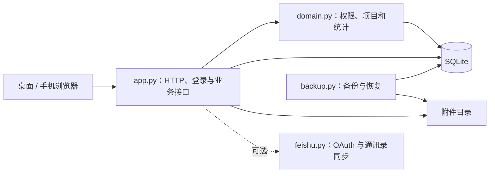

# 架构说明

轻舟是一个单进程 Web 应用：后端使用 Python 标准库提供 HTTP 和 JSON 接口，SQLite 保存结构化数据，前端由浏览器直接加载原生脚本与样式。无需独立前端构建或第三方运行依赖。

## 模块分工

| 模块 | 职责 |
| --- | --- |
| `app.py` | 命令行和环境配置、HTTP 路由、会话与 CSRF、输入校验、业务写入、上传与导出 |
| `domain.py` | 数据结构迁移、多级项目关系、参与日期、角色授权、周报可见性及统计 |
| `feishu.py` | 配置读取、OAuth、服务端令牌、只读通讯录镜像及同步调度 |
| `backup.py` | SQLite 在线备份、附件快照、校验清单及离线恢复 |
| `static/app.js` | 登录、导航、通用交互、草稿及上传 |
| `static/management.js` | 填报、项目与成员管理 |
| `static/overview.js` | 个人、部门及公司总览 |
| `static/projects.js` | 可展开的项目树 |

## 数据与权限

项目通过父子关系形成 WBS 树，参与关系和查看授权独立配置。项目负责人、部门负责人、参与人、查看人与管理员拥有不同的数据范围。服务端在读取、写入、统计、下载和导出时检查授权，不能依赖隐藏前端按钮实现权限控制。

周报以人员、项目和周关联，记录进度、投入与工作内容；休假及其他分类投入与项目投入合并校验，每周必须为 100%。同一人对多个项目的周报在提交时作为整体校验和写入。协调事项记录处理状态、处理人和处理时间。

附件元数据存储于 SQLite，文件保存在独立目录，使用随机存储名。下载通过后端鉴权，完整备份同时包含数据库和附件。

本地模式在首次启动时创建管理员，密码使用带随机盐的 PBKDF2-HMAC-SHA256 保存。会话存储令牌摘要，并检查有效期；写接口检查会话和 CSRF。测试覆盖越权、跨部门可见性、附件访问和导出权限。

## 可选飞书接入

默认采用本地账号。飞书模式使用应用范围内的 App ID + Open ID 识别身份，通讯录字段由同步程序维护，业务角色和项目关系保留在本系统中。完整同步成功后更新镜像，失败时保留原有数据。详见 [飞书接入](feishu-integration.md)。

飞书消息提醒、审批流、实时人员事件和多实例运行尚未实现。

## 运行与学习入口

服务使用 `ThreadingHTTPServer` 处理请求，SQLite 启用 WAL。启动时执行兼容迁移，保留已有数据；生产升级前仍需完整备份。部署时使用单个应用实例，数据容量和并发能力应按实际场景验证。

阅读建议：先看 `app.py` 的 `main()`、`Server` 和 `Handler`，结合 `tests/test_app.py` 理解真实 HTTP 请求；再看 `domain.py` 与角色测试理解授权；最后看备份测试学习在线快照与恢复校验。
