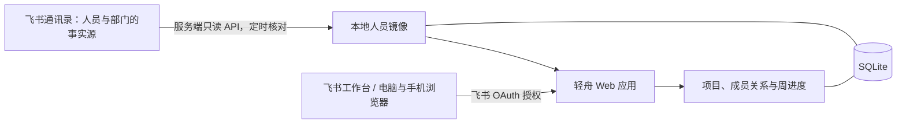

# 轻舟 · 飞书接入与部署方案

## 选型结论

面向约 100 人、只需要项目和个人进度的团队，采用 **响应式 Web 应用 + 飞书企业自建应用**：飞书工作台放置网页入口，同一个地址可在普通浏览器访问。员工以飞书身份登录，系统通过只读 API 同步人员与组织，无需人工创建员工账号。

保留当前 Python 单体应用、原生前端和 SQLite，一台服务器运行一个应用进程和内置同步线程。以当前低频填报场景作为轻量起步方案；实际容量仍应按公司的项目数量、历史数据量和访问频率验证。部署时通过 HTTPS 反向代理访问，并配置进程守护与数据库备份。没有引入独立前端构建、Redis、消息队列或多个业务服务的必要。

飞书多维表格适合更快搭建简单收集表；这里已经需要按本人登录、比例校验、项目权限和历史追踪，因此继续使用现有 Web 应用更容易控制业务规则。第一版无需另做小程序或原生客户端。



## 同步与人员生命周期

人员信息由飞书维护，本地 `users` 表中的飞书姓名、部门、身份 ID、状态与同步时间只允许同步程序更新。`role` 是本系统的业务权限，不从飞书部门负责人或飞书管理员身份自动推导。项目成员关系、负责人和历史填报独立保存。

### 当前实现

1. 使用企业自建应用的 App ID / App Secret 获取 `tenant_access_token`，在服务端缓存，按飞书返回的过期时间更新。
2. 以应用身份读取根部门 `0` 的直属人员。这一步同时校验应用有全员通讯录读取范围。
3. 分页获取根部门的全部子部门，再分别分页读取各部门直属用户；统一使用 `open_id` 和 `open_department_id`。
4. 同一个人出现在多个部门时，按应用内 Open ID 去重并保留多部门关系。
5. 完成全部分页、字段和状态校验后，在一次 SQLite 事务中更新本地镜像。
6. 自动新增新员工镜像，更新姓名和部门；冻结、离职、已退出或未激活状态不允许登录。完整核对后不再出现的员工标记为“不在本次完整通讯录范围”，而非直接宣称已经离职。
7. 停用镜像会撤销已有的本地会话，历史项目和填报记录保留。

任何网络、权限、分页或字段异常都会中止本轮，不把部分列表覆盖到本地。空通讯录也不会覆盖现有人员。业务数据与本地演示账号不会依据同名姓名或手机号自动合并。

### 调度选择

当前采用**启动即同步 + 默认每 15 分钟全量核对 + 管理员手动同步**。这是定时全量核对，不是“按更新时间拉取过去 24 小时变化”。100 人是否只需几次调用取决于部门数量和分页，不能承诺固定一秒完成。

在同步正常运行时，已登录人员的停用最长通常在一个同步周期后生效；新登录还会通过飞书 API 核实账号当前状态。同步失败会保留上一次镜像并显示失败，不能承诺此时离职会话按固定时限失效。

若公司要求人员停用近实时生效，下一阶段使用飞书官方 SDK 的长连接事件订阅处理人员变更，再用定时全量核对补偿漏事件。当前没有实现实时事件订阅，不把轮询描述为即时同步。

## 登录与身份

使用 OAuth 授权码流程，服务端通过当前 v3 令牌端点换取短期用户令牌，再获取用户身份。飞书内可继续授权；普通浏览器进入飞书授权页完成登录。这里没有接入 JS SDK 无感免登，不保证任何客户端都完全没有授权界面。

身份关联固定采用 **App ID + Open ID**。Open ID 是应用范围内的 ID，更换 App ID 时不能直接复用或按姓名合并，需单独处理身份关联。`user_id` 可作为后续跨应用关联的可选字段，本版不申请它，也不在缺字段时临时切换 ID 类型。

登录保护包括一次性 `state`、浏览器 Cookie 绑定、十分钟本地状态有效期与 PKCE S256；飞书授权码本身的有效期以官方限制为准。用户令牌仅用于本次核实身份，不持久化；通讯录同步使用应用令牌，不依赖某位员工保持登录。飞书模式下本地注册、密码登录、密码修改及人工创建人员接口均不可使用。

## 飞书后台配置

### 企业自建应用

由企业有权限的管理员/开发者在飞书开放平台创建企业自建应用，启用网页能力，设置电脑和手机的应用首页。创建版本，经过企业审批并发布；测试范围配置与正式发布范围应分别核实。

以下是三件独立的事，不能只配置“应用可用范围”：

| 配置 | 用途 | 本系统建议 |
| --- | --- | --- |
| 应用可用范围 | 哪些员工可以使用应用 | 需要填报的员工 |
| 通讯录数据权限范围 | 应用能读哪些部门和人员 | 当前实现需要全员范围 |
| API 与字段权限 | 能调用哪些接口、拿到哪些字段 | 只读，并按实际字段申请 |

### API 与字段权限

通过当前接口文档或 API 调试台申请只读权限，而非申请通讯录写权限。接口权限和字段权限都要检查，不能简单理解为“两个接口就是两个权限”。

| 数据/接口 | 说明 |
| --- | --- |
| 自建应用获取应用令牌 | 后端用应用凭证调用，只保存在后端 |
| 获取子部门列表 | 部门名称、ID、父部门与完整子部门遍历所需权限 |
| 获取部门直属用户列表、获取单个用户信息 | 读取姓名、Open ID、部门和账号状态；登录时核实当前账号状态 |
| 获取用户信息 | 获取 OAuth 登录者 Open ID；无需为登录申请全员的个人通讯录读取权限 |

在后台按文档检查“获取通讯录基本信息”“获取用户基本信息”“获取用户组织架构信息”、部门基本/组织架构信息，以及人员状态字段对应的权限。实际权限编码、字段归属和审批结果以当前飞书后台为准。若同步提示缺少姓名、部门或状态，应补足对应字段只读权限，不把缺失的状态默认当作在职。

本版不读取或存储手机号、个人邮箱、员工工号、职级、薪酬等业务不需要的字段。不申请额外的用户 User ID 权限。飞书响应中即使带有多余字段，镜像也仅选取需要的字段。

## 配置与启动

复制 `.env.example` 为 `.env`，在服务器本地填写：

| 配置项 | 作用 |
| --- | --- |
| `PMS_AUTH_MODE=feishu` | 开启飞书模式，禁用本地用户管理与密码认证 |
| `FEISHU_APP_ID` | 自建应用 App ID |
| `FEISHU_APP_SECRET` | 自建应用密钥，仅存服务端环境配置 |
| `FEISHU_REDIRECT_URI` | 完整回调地址，例如 `https://pms.example.com/api/auth/feishu/callback` |
| `FEISHU_ADMIN_OPEN_IDS` | 初始管理员在该应用下的 Open ID，多个用逗号分隔 |
| `FEISHU_TENANT_KEY` | 可选，额外校验登录企业 |
| `FEISHU_SYNC_INTERVAL` | 同步间隔秒数，默认 900，允许 60–86400 |
| `PMS_SECURE_COOKIE=1` | 正式 HTTPS 部署启用安全 Cookie |
| `PMS_HOST=127.0.0.1` | HTTPS 代理访问后端，本地服务不直接暴露公网 |

初始管理员 Open ID 可由有权限的开发者在**同一个应用**的 API 调试台，通过通讯录接口查询取得；不要使用其他应用获取的 Open ID。指定管理员后，系统自动同步该员工并授予管理员角色。额外管理员可以在系统中调整。配置中的初始管理员会在每次同步时重新获得管理员权限，撤销这类权限需先更改配置。

在飞书应用的安全设置中，将回调 URL 原样加入 OAuth 重定向 URL 列表，协议、域名、端口和路径必须一致。回调不带 `#` 或查询参数。公司管理员应使用正式域名替换示例域名。

```powershell
Copy-Item .env.example .env
# 编辑 .env 填入配置。
python app.py --sync-feishu
python app.py
```

部署配置必须同时填写在服务端并完成飞书后台审批。没有真实企业凭证时，不能仅靠代码或本地模拟就完成真实通讯录联通。

## 网络与运行方式

建议部署在公司自有服务器或公司控制的云主机，通过公司 HTTPS 域名访问。员工能访问应用网页和 OAuth 回调地址，服务端能出网访问 `open.feishu.cn` 与 `accounts.feishu.cn`。

本版使用定时拉取，没有要求飞书平台主动向服务器发送事件回调；因此可以采用内网域名与 VPN，只要员工浏览器能访问该域名、飞书后台接受并登记该重定向地址且后端可出网。若改用公网事件回调，再单独处理事件服务器的公网可达性和验签。

当前 HTTP 服务是轻量实现，适合内网起步。应由反向代理负责 HTTPS、请求大小及超时限制；应用运行一个实例，避免重复调度。必须配置进程自启/守护以及 SQLite 备份。若今后需要公开互联网服务、多实例或高并发，再迁移到成熟的 ASGI/WSGI 服务部署及 PostgreSQL，并把同步任务独立运行。

周报附件集中保存到数据库旁的 `attachments/`（默认 `data/attachments/`），可用 `PMS_UPLOAD_DIR` 或 `--uploads` 指定独立目录。SQLite 保存附件元数据和周报关联。服务器账号需能读写数据库和附件目录，完整备份/迁移需同时覆盖两部分；反向代理需允许至少 20 MB 的单文件上传请求及合适的上传超时。管理员可在团队页分别导出填报 CSV 和已提交附件 ZIP，ZIP 附有项目、成员和周的文件清单。周报休假登记独立保存在本系统，不修改飞书人员状态，不读取飞书请假或考勤数据。

`.env`、数据库和令牌不得提交到仓库。当前 `.gitignore` 已排除 `.env` 与 `data/`；密钥不要通过聊天传递。设置系统时间并保持校时，以便会话、同步与 OAuth 状态过期正常工作。

## 实现与验证状态

- 已实现：飞书授权登录、当前 v3 令牌接口、人员/部门全量分页、定时与手动同步、镜像只读、业务角色管理、停用会话撤销、保留历史记录。
- 已验证：临时数据库集成测试，以及模拟飞书授权跳转和 API 的浏览器验收；原项目填报流程也保留回归验收。
- 待企业联调：真实凭证、权限与字段返回、全员读取范围、企业发布、域名与回调、安全 Cookie 和飞书客户端体验。
- 尚未实现：JS SDK 无感免登、人员变更实时事件、飞书消息提醒、审批以及多实例运行。

## 官方参考

- [获取部门直属用户列表](https://open.feishu.cn/document/server-docs/contact-v3/user/find_by_department)
- [获取子部门列表](https://open.feishu.cn/document/server-docs/contact-v3/department/children)
- [获取通讯录授权范围](https://open.feishu.cn/document/server-docs/contact-v3/scope/list)
- [获取授权码](https://open.feishu.cn/document/authentication-management/access-token/obtain-oauth-code)
- [获取 user_access_token：v3](https://open.feishu.cn/document/uAjLw4CM/ukTMukTMukTM/authentication-management/access-token/get-user-access-token-v3)
- [获取用户信息](https://open.feishu.cn/document/server-docs/authentication-management/login-state-management/get)
- [用户身份 ID 说明](https://open.feishu.cn/document/platform-overveiw/basic-concepts/user-identity-introduction/introduction)
